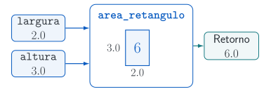
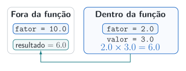

## Uma função dá nome a uma operação

Uma função reúne instruções que podemos reutilizar. `def` define a função, os parâmetros dão nome às entradas e `return` devolve o resultado.

```{pyodide}
#| autorun: true
#| min-lines: 4
#| max-lines: 10
def area_retangulo(largura, altura):
    return largura * altura

area = area_retangulo(2.0, 3.0)
print(f"Área: {area}")
```

**Experimente:** calcule outra área sem copiar a multiplicação.

## Entradas, cálculo e retorno {.diagram-slide}

Os argumentos `2.0` e `3.0` fornecem largura e altura. A função calcula a área do retângulo e `return` devolve `6.0`.

{.diagrama fig-alt="A função area_retangulo recebe largura 2.0 e altura 3.0. Um retângulo com essas dimensões tem área 6, e a função retorna 6.0."}

## Definir e chamar são etapas diferentes {.output-columns}

A definição registra o que a função fará; a chamada executa suas instruções. Parênteses após o nome indicam a chamada e contêm os argumentos.

```{pyodide}
#| autorun: true
#| min-lines: 4
#| max-lines: 10
def calcular_dobro(valor):
    print("A função foi chamada.")
    return 2.0 * valor

print("A definição terminou.")
print(calcular_dobro(3.0))
```

**Preveja:** em que ordem as mensagens aparecem?

## Argumentos por posição ou por nome

Os argumentos são os valores fornecidos na chamada. Eles podem seguir a ordem dos parâmetros ou indicar seus nomes explicitamente.

```{pyodide}
#| autorun: true
#| min-lines: 4
#| max-lines: 10
def area_retangulo(largura, altura):
    return largura * altura

print(area_retangulo(2.0, 3.0))
print(area_retangulo(altura=3.0, largura=2.0))
```

**Experimente:** altere as medidas nas duas chamadas e confira os resultados.

## `return`: devolver para reutilizar

`return` entrega um resultado a quem chamou a função. Esse valor pode ser guardado, apresentado ou usado como entrada de outro cálculo.

```{pyodide}
#| autorun: true
#| min-lines: 4
#| max-lines: 10
def calcular_dobro(valor):
    return 2.0 * valor

dobro = calcular_dobro(3.0)
print(dobro)
print(dobro + 1.0)
```

**Experimente:** use o retorno para calcular o quadrado do dobro.

## `print`: apresentar uma mensagem

`print` mostra uma informação. Uma função sem `return` explícito devolve `None`, mesmo quando exibe um resultado na tela.

```{pyodide}
#| autorun: true
#| min-lines: 4
#| max-lines: 10
def imprimir_dobro(valor):
    print(f"Dobro: {2.0 * valor}")

retorno = imprimir_dobro(3.0)
print(f"Retorno guardado: {retorno}")
```

**Observe:** o número apareceu, mas o retorno guardado foi `None`.

## Parâmetros com valores padrão

Um valor padrão é usado quando o argumento é omitido. Parâmetros obrigatórios vêm antes dos parâmetros com padrão, e o padrão deve ter um significado claro.

```{pyodide}
#| autorun: true
#| min-lines: 4
#| max-lines: 10
def multiplicar_por_fator(valor, fator=1.0):
    return fator * valor

print(multiplicar_por_fator(8.0))
print(multiplicar_por_fator(8.0, fator=0.5))
```

**Experimente:** escolha outro fator. O que acontece quando ele é omitido?

## Devolver dois resultados

Uma função pode devolver uma tupla. O desempacotamento associa cada resultado a um nome; mantenha uma ordem que seja fácil de explicar.

```{pyodide}
#| autorun: true
#| min-lines: 4
#| max-lines: 10
def descrever_intervalo(inicio, fim):
    ponto_medio = (inicio + fim) / 2.0
    comprimento = fim - inicio
    return ponto_medio, comprimento

ponto_medio, comprimento = descrever_intervalo(1.0, 3.0)
print(ponto_medio, comprimento)
```

**Experimente:** use outro intervalo e confira cada resultado.

## Escopo: nomes locais à função {.output-columns}

Parâmetros e nomes atribuídos no corpo são locais à função. Prefira receber os dados necessários como argumentos, deixando claras as dependências do cálculo.

```{pyodide}
#| autorun: true
#| min-lines: 4
#| max-lines: 10
fator = 10.0
def aplicar_fator_local(valor):
    fator = 2.0
    return fator * valor

print(aplicar_fator_local(3.0))
print(fator)
```

**Observe:** a atribuição local não alterou o nome `fator` definido fora.

::: {.notes}
Escopo de nomes não implica copiar os objetos recebidos. Uma função pode modificar uma lista que recebeu como argumento; os próximos exemplos preservam a entrada deliberadamente.
:::

## Mesmo nome, escopos distintos {.diagram-slide}

O `fator` local recebe `2.0`; o externo continua com `10.0`. A função usa seu fator local e retorna `6.0`.

{.diagrama fig-alt="Fora da função, fator vale 10.0. Dentro, fator vale 2.0 e valor vale 3.0. O cálculo retorna 6.0 para resultado, preservando o fator externo."}

## Docstring: explicar o contrato

Uma *docstring* é o texto entre aspas triplas no início do corpo. Ela explica o significado das entradas e do resultado, incluindo hipóteses e unidades quando necessário.

```{pyodide}
#| autorun: true
#| min-lines: 4
#| max-lines: 10
def calcular_comprimento(inicio, fim):
    """Retorna fim - inicio, com extremos na mesma unidade."""
    return fim - inicio

print(calcular_comprimento(0.0, 1.0))
print(calcular_comprimento.__doc__)
```

**Experimente:** explique uma hipótese que o texto ainda não menciona.

## Anotações de tipo ajudam a leitura

`inicio: float` indica um tipo esperado e `-> float`, o tipo do retorno. As anotações ajudam a leitura e permitem que o editor e ferramentas de checagem identifiquem incompatibilidades.

```{pyodide}
#| autorun: true
#| min-lines: 4
#| max-lines: 10
def calcular_comprimento(inicio: float, fim: float) -> float:
    """Retorna fim - inicio."""
    return fim - inicio

print(calcular_comprimento(0.0, 1.0))
```

**Observe:** o cálculo é o mesmo da versão anterior; a intenção está mais explícita.

## Tipos básicos nas assinaturas {.output-columns .code-wide}

`float`, `int`, `str` e `bool` indicam os tipos esperados. `-> None` informa que a função devolve `None`, como ocorre em uma ação que apenas apresenta uma mensagem.

```{pyodide}
#| autorun: true
#| min-lines: 4
#| max-lines: 10
def descrever_medicao(nome: str, disponivel: bool) -> str:
    return f"{nome}: disponível = {disponivel}"

def apresentar_repeticoes(quantidade: int) -> None:
    print(f"Repetições: {quantidade}")

print(descrever_medicao("Sensor A", True))
apresentar_repeticoes(3)
```

## O tipo dos itens de uma coleção

`list[float]` descreve uma lista cujos itens são esperados como números de ponto flutuante. A anotação do retorno também descreve a lista produzida.

```{pyodide}
#| autorun: true
#| min-lines: 4
#| max-lines: 10
def elevar_ao_quadrado(valores: list[float]) -> list[float]:
    return [valor**2 for valor in valores]

print(elevar_ao_quadrado([0.0, 0.5, 1.0]))
```

## Checar compatibilidades com mypy

`mypy` analisa as partes anotadas sem executar o programa. Salve este exemplo estático em `arquivo.py` para conferir a chamada.

```python
def calcular_comprimento(inicio: float, fim: float) -> float:
    return fim - inicio

# Incompatível: o segundo argumento é um texto.
comprimento = calcular_comprimento(0.0, "1.0")
```

```sh
pixi run mypy arquivo.py
```

**Corrija:** troque `"1.0"` por `1.0` e confira novamente.

::: {.notes}
Este trecho é intencionalmente estático: o aluno deve executar o verificador de tipos, não o arquivo Python com a chamada incompatível. As anotações não são impostas pelo Python durante a execução, e a checagem de tipos não demonstra correção numérica. Ela complementa a validação de entradas e as verificações de resultados das próximas seções.
:::

## Validar os dados recebidos

As anotações não validam valores durante a execução nem garantem correção numérica. `raise ValueError` rejeita dados inadequados; aqui exigimos `fim > inicio`.

```{pyodide}
#| autorun: true
#| min-lines: 4
#| max-lines: 10
def comprimento_positivo(inicio: float, fim: float) -> float:
    if fim <= inicio:
        raise ValueError("O fim deve ser maior que o início.")
    return fim - inicio

print(comprimento_positivo(0.0, 1.0))
```

**Experimente:** use outro intervalo válido.

## Estudar uma exceção esperada {.output-columns}

`try` executa um bloco e `except ValueError` trata esse tipo de erro. Leia a mensagem e identifique a regra violada antes de decidir como corrigir os dados.

```{pyodide}
#| autorun: true
#| min-lines: 4
#| max-lines: 10
def comprimento_positivo(inicio: float, fim: float) -> float:
    if fim <= inicio:
        raise ValueError("O fim deve ser maior que o início.")
    return fim - inicio
try:
    print(comprimento_positivo(1.0, 0.0))
except ValueError as erro:
    print(f"ValueError: {erro}")
```

**Experimente:** use extremos válidos. O bloco `except` ainda será executado?

## `None` como argumento opcional {.output-columns .code-wide}

`int | None` aceita um inteiro ou a ausência de uma opção. Devolvemos outra lista; o padrão `None` evita compartilhar uma lista mutável entre chamadas.

```{pyodide}
#| autorun: true
#| min-lines: 4
#| max-lines: 10
def selecionar_primeiros(
    valores: list[float], quantidade: int | None = None
) -> list[float]:
    if quantidade is None:
        return valores.copy()
    return valores[:quantidade]

medicoes = [20.0, 21.0, 22.0]
print(selecionar_primeiros(medicoes))
print(selecionar_primeiros(medicoes, quantidade=2))
```

**Experimente:** selecione somente o primeiro item.

## Verificar números com tolerância

`math.isclose` compara dois escalares com tolerâncias relativa e absoluta. A absoluta ajuda perto de zero; a escolha deve considerar a escala e a precisão esperada do cálculo.

```{pyodide}
#| autorun: true
#| min-lines: 4
#| max-lines: 10
import math
soma = 0.1 + 0.2
print(soma == 0.3)
print(math.isclose(soma, 0.3, rel_tol=1e-12, abs_tol=1e-12))
print(math.isclose(1e-14, 0.0, abs_tol=1e-12))
```

**Experimente:** compare `1e-6` com zero usando a mesma tolerância absoluta.

::: {.notes}
Para valores finitos, a condição é abs(a-b) <= max(rel_tol * max(abs(a), abs(b)), abs_tol). As tolerâncias escolhidas aqui não são uma recomendação universal para simulações.
:::

## Verificações com resultados conhecidos

`assert` verifica uma condição no desenvolvimento. Confira resultados que possam ser justificados independentemente da implementação, como a área de um retângulo conhecido.

```{pyodide}
#| autorun: true
#| min-lines: 4
#| max-lines: 10
import math
def area_retangulo(largura: float, altura: float) -> float:
    return largura * altura

area = area_retangulo(2.0, 3.0)
assert math.isclose(area, 6.0, rel_tol=1e-12, abs_tol=1e-12)
print("A verificação passou.")
```

**Observe:** executar sem erro só prova o caso que foi verificado.

::: {.notes}
`assert` pode ser desativado ao executar Python com otimizações. Para validar entradas de uma função, usar `raise`, como já apresentado.
:::

## Uma expressão matemática como função

Uma função Python também representa uma regra matemática. Em $0 \leq x \leq 1$, vamos avaliar $u(x)=x(1-x)$ em alguns pontos.

```{pyodide}
#| autorun: true
#| min-lines: 4
#| max-lines: 10
def solucao_referencia(posicao: float) -> float:
    return posicao * (1.0 - posicao)

for posicao in [0.0, 0.5, 1.0]:
    print(f"u({posicao}) = {solucao_referencia(posicao)}")
```

**Experimente:** acrescente `0.25`. Qual é o valor da função nesse ponto?

::: {.notes}
Esta é uma avaliação de uma expressão fornecida, não a solução computacional de uma equação. A expressão também é solução de referência para Poisson com fonte 2 e condições homogêneas nos extremos.
:::

## Uma função pode receber outra função {.output-columns .code-wide}

`Callable[[float], float]` descreve uma função de `float` para `float`.

```{pyodide}
#| autorun: true
#| min-lines: 4
#| max-lines: 10
from collections.abc import Callable

def solucao_referencia(posicao: float) -> float:
    return posicao * (1.0 - posicao)

def avaliar_em_pontos(
    funcao: Callable[[float], float], pontos: list[float]
) -> list[float]:
    return [funcao(ponto) for ponto in pontos]

pontos = [0.0, 0.25, 0.5, 0.75, 1.0]
print(avaliar_em_pontos(solucao_referencia, pontos))
```

**Observe:** `solucao_referencia` passa a regra; `solucao_referencia(0.5)` calcula um valor.

## Separar cálculo e apresentação {.output-columns .code-wide}

Uma função pequena tem uma responsabilidade clara. Aqui, ela calcula erros absolutos; a escolha de como apresentar os resultados fica fora do cálculo.

```{pyodide}
#| autorun: true
#| min-lines: 4
#| max-lines: 10
def erros_absolutos(
    valores: list[float], referencias: list[float]
) -> list[float]:
    pares = zip(valores, referencias, strict=True)
    return [abs(valor - referencia) for valor, referencia in pares]

referencias = [0.0, 0.25, 0.0]
aproximacoes = [0.0, 0.24, 0.0]
erros = erros_absolutos(aproximacoes, referencias)
print(erros)
print(f"Maior erro nos pontos: {max(erros):.3f}")
```

**Experimente:** mude a mensagem sem alterar a função.

::: {.notes}
`strict=True` rejeita comprimentos diferentes. O máximo mede o erro apenas nos pontos informados, não em todo um intervalo.
:::

## Continuar estudando

No [notebook suplementar](suplementos/notebooks/03-funcoes.ipynb), pratique funções, validação de entradas e verificações numéricas.

Para cada função, identifique suas entradas, seu retorno e suas hipóteses. Essa organização permitirá reutilizar o cálculo em outros cadernos e módulos.

O [próximo notebook](suplementos/notebooks/04-classes-basicas.ipynb) apresenta os fundamentos de classes.

## Referências

- [Python: definição de funções](https://docs.python.org/pt-br/3/tutorial/controlflow.html#defining-functions)
- [Python: erros e exceções](https://docs.python.org/pt-br/3/tutorial/errors.html)
- [Python: `math.isclose`](https://docs.python.org/pt-br/3/library/math.html#math.isclose)
- [Python: anotações de tipos](https://docs.python.org/pt-br/3/library/typing.html)
- [Mypy: primeiros passos](https://mypy.readthedocs.io/en/stable/getting_started.html)

