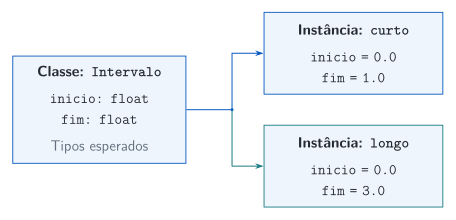
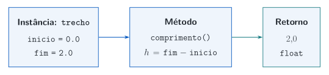

## Dados que descrevem um intervalo

Um intervalo reúne dois extremos. A função usa esses dados para calcular uma propriedade: o comprimento $h=b-a$.

```{pyodide}
def comprimento(inicio: float, fim: float) -> float:
    return fim - inicio

inicio = 0.0
fim = 2.0
print(comprimento(inicio, fim))
```

Vamos reunir os extremos e as operações em um objeto.

## Uma classe define um tipo de objeto {.output-columns .code-wide}

`class` define um novo tipo. A chamada `Intervalo(0.0, 2.0)` constrói uma **instância**; a atribuição `trecho = ...` associa esse objeto ao nome `trecho`.

```{pyodide}
class Intervalo:
    def __init__(self, inicio: float, fim: float) -> None:
        self.inicio = inicio
        self.fim = fim

trecho = Intervalo(0.0, 2.0)
print(type(trecho).__name__)
print(trecho.inicio, trecho.fim)
```

Os tipos continuam explícitos nas entradas dos métodos.

## Classe e instâncias {.diagram-slide}

A classe descreve como criar os objetos. Cada chamada constrói uma instância com seus próprios valores de `inicio` e `fim`.

{.diagrama fig-alt="A classe Intervalo define inicio e fim. Duas chamadas constroem as instâncias curto com extremos zero e um e longo com extremos zero e três."}

## Atributos guardam os dados {.output-columns .code-wide}

Um **atributo** é uma informação associada ao objeto. O ponto em `trecho.fim` acessa o atributo `fim` daquela instância.

```{pyodide}
class Intervalo:
    def __init__(self, inicio: float, fim: float) -> None:
        self.inicio = inicio
        self.fim = fim

trecho = Intervalo(0.0, 2.0)
print("Início:", trecho.inicio)
print("Fim:", trecho.fim)
```

`inicio` é um parâmetro; `self.inicio` é o atributo que guarda seu valor.

## `__init__` prepara a nova instância {.output-columns .code-wide}

Python chama `__init__` durante a construção. O método inicializa os atributos e retorna `None`; a chamada da **classe** é que fornece a instância.

```{pyodide}
class Intervalo:
    def __init__(self, inicio: float, fim: float) -> None:
        self.inicio = inicio
        self.fim = fim

primeiro = Intervalo(0.0, 1.0)
segundo = Intervalo(2.0, 5.0)
print(primeiro.fim, segundo.fim)
```

Não escrevemos `return self` em `__init__`.

## Um método usa os atributos da instância {.output-columns .code-wide}

Um **método** é uma função definida na classe. `comprimento` lê os extremos do objeto e devolve um `float`.

```{pyodide}
class Intervalo:
    def __init__(self, inicio: float, fim: float) -> None:
        self.inicio = inicio
        self.fim = fim

    def comprimento(self) -> float:
        return self.fim - self.inicio

trecho = Intervalo(0.0, 2.0)
print(trecho.comprimento())
```

Usamos `trecho.fim` para ler um dado e `trecho.comprimento()` para executar uma operação.

## Dados, método e resultado {.diagram-slide}

`self` identifica o objeto recebido pelo método. O comprimento é calculado a partir dos atributos daquela instância.

{.diagrama fig-alt="A instância trecho guarda inicio zero e fim dois. O método comprimento lê esses atributos, calcula fim menos inicio e retorna o valor 2.0."}

## A chamada fornece `self` {.output-columns .code-wide}

Em `trecho.comprimento()`, Python passa `trecho` como primeiro argumento do método. `self` é o nome convencional desse parâmetro.

```{pyodide}
class Intervalo:
    def __init__(self, inicio: float, fim: float) -> None:
        self.inicio, self.fim = inicio, fim

    def comprimento(self) -> float:
        return self.fim - self.inicio

trecho = Intervalo(0.0, 2.0)
print(trecho.comprimento())
print(Intervalo.comprimento(trecho))
```

A primeira forma é a que usaremos normalmente.

## Mesma classe, estados diferentes {.diagram-slide}

O **estado** reúne os valores dos atributos. O mesmo método produz comprimentos diferentes porque cada instância tem seu próprio estado.

{.diagrama fig-alt="Duas instâncias de Intervalo: curto vai de zero a um e longo vai de zero a três, com comprimentos um e três."}

## Métodos também recebem argumentos {.output-columns .code-wide}

Além de `self`, um método pode receber dados da chamada. `contem` verifica se uma posição pertence ao intervalo fechado $[a,b]$ e retorna `bool`.

```{pyodide}
class Intervalo:
    def __init__(self, inicio: float, fim: float) -> None:
        self.inicio, self.fim = inicio, fim

    def contem(self, posicao: float) -> bool:
        return self.inicio <= posicao <= self.fim

trecho = Intervalo(0.0, 2.0)
print(trecho.contem(1.5))
print(trecho.contem(3.0))
```

**Experimente:** consulte os dois extremos do intervalo.

## Alterar um atributo muda o estado {.output-columns .code-wide}

Nesta classe, os atributos são mutáveis. O método consulta os valores atuais a cada chamada; não há um comprimento armazenado que precise ser atualizado.

```{pyodide}
class Intervalo:
    def __init__(self, inicio: float, fim: float) -> None:
        self.inicio, self.fim = inicio, fim

    def comprimento(self) -> float:
        return self.fim - self.inicio

trecho = Intervalo(0.0, 2.0)
print(trecho.comprimento())
trecho.fim = 3.0
print(trecho.comprimento())
```

Alterações diretas nos atributos também podem violar as hipóteses do modelo.

## Dois nomes podem acessar o mesmo objeto {.output-columns .code-wide}

A atribuição `outro = trecho` associa outro nome à mesma instância. Ela não cria uma cópia do intervalo.

```{pyodide}
class Intervalo:
    def __init__(self, inicio: float, fim: float) -> None:
        self.inicio, self.fim = inicio, fim

trecho = Intervalo(0.0, 2.0)
outro = trecho
outro.fim = 4.0
print(trecho.fim)
print(outro is trecho)
```

**Observe:** os dois nomes acessam os mesmos atributos.

## Objetos também podem ficar em uma lista {.output-columns .code-wide}

`list[Intervalo]` indica uma lista de instâncias dessa classe. O laço percorre objetos e chama o método de cada um.

```{pyodide}
class Intervalo:
    def __init__(self, inicio: float, fim: float) -> None:
        self.inicio, self.fim = inicio, fim

    def comprimento(self) -> float:
        return self.fim - self.inicio

trechos: list[Intervalo] = [Intervalo(0.0, 0.5), Intervalo(0.5, 2.0)]
for trecho in trechos:
    print(trecho.comprimento())
```

Uma lista de objetos continua usando as estruturas que já conhecemos.

## Uma função pode receber um objeto {.output-columns .code-wide}

O nome da classe também pode aparecer na anotação de tipo. `descrever` espera um `Intervalo` e devolve um texto.

```{pyodide}
class Intervalo:
    def __init__(self, inicio: float, fim: float) -> None:
        self.inicio, self.fim = inicio, fim

def descrever(intervalo: Intervalo) -> str:
    return f"Intervalo de {intervalo.inicio} até {intervalo.fim}."

trecho = Intervalo(0.0, 2.0)
print(descrever(trecho))
```

O verificador de tipos pode detectar uma chamada como `descrever("texto")`.

## Tipos e validação se complementam {.output-columns .code-wide}

As anotações ajudam a detectar incompatibilidades de tipos. A condição `fim > inicio` é uma regra do modelo e precisa ser verificada explicitamente.

```{pyodide}
class Intervalo:
    def __init__(self, inicio: float, fim: float) -> None:
        if fim <= inicio:
            raise ValueError("O fim deve ser maior que o início.")
        self.inicio, self.fim = inicio, fim

try:
    trecho = Intervalo(2.0, 1.0)
except ValueError as erro:
    print(erro)
```

Os argumentos têm os tipos esperados, mas os valores não formam um intervalo válido.

::: {.notes}
Os exemplos usam extremos reais finitos na mesma unidade. A condição de ordem não rejeita NaN por si só. Atributos mutáveis podem ser alterados depois da construção; a aula de organização e dataclasses retoma essas limitações com validação de dados de malha.
:::

## Escolher uma responsabilidade clara

::: {.columns}
::: {.column width="48%"}
### Função

Recebe dados, realiza uma operação e devolve um resultado.

`comprimento(inicio, fim)`

É adequada para um cálculo independente.
:::
::: {.column width="48%"}
### Classe

Reúne dados de um objeto e operações sobre seu estado.

`trecho.comprimento()`

É adequada quando essa associação ajuda a organizar o programa.
:::
:::

Uma classe deve tornar o código mais legível; não precisamos transformar todo cálculo em um objeto.

## Continuar estudando

No [notebook suplementar](suplementos/notebooks/04-classes-basicas.ipynb), pratique atributos, métodos, instâncias e validação.

A partir daqui, manteremos tipos explícitos nas interfaces das funções e dos métodos. Eles dão uma camada adicional de verificação com ferramentas como o mypy, junto das verificações dos resultados científicos.

### Referências

- [Python: classes](https://docs.python.org/pt-br/3.13/tutorial/classes.html)
- [Python: anotações de tipos](https://docs.python.org/3.13/library/typing.html)
