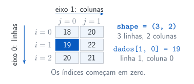
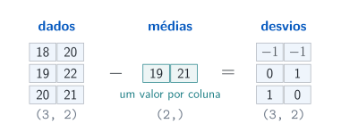

## O que é um array?

Um `ndarray` organiza valores de um mesmo tipo em eixos. O NumPy oferece operações numéricas sobre esses valores.

```{pyodide}
import numpy as np

posicoes = np.array([0.0, 0.25, 0.5, 0.75, 1.0])
print("Valores:", posicoes)
print("Tipo numérico:", posicoes.dtype)
```

## `shape` descreve as dimensões

`shape` é uma tupla com o tamanho de cada eixo; `ndim` conta os eixos. Um vetor `(3,)` difere de uma matriz com uma linha `(1, 3)`.

```{pyodide}
import numpy as np

vetor = np.array([1.0, 2.0, 3.0])
linha = vetor.reshape(1, 3)
print("Vetor:", vetor.shape, "| eixos:", vetor.ndim)
print("Linha:", linha.shape, "| eixos:", linha.ndim)
```

## Tipos na interface numérica {.output-columns}

`np.ndarray` comunica que a função espera um array. A anotação não valida dtype, shape ou valores e não converte os dados.

```{pyodide}
import numpy as np

def quadrados(x: np.ndarray) -> np.ndarray:
    return x**2
valores = np.array([1.0, 2.0, 3.0])
print(quadrados(valores))
```

## Criar dados com significado

`linspace` escolhe uma quantidade de pontos, incluindo os extremos por padrão. `arange` avança por um passo; para índices, use inteiros.

```{pyodide}
import numpy as np

pontos = np.linspace(0.0, 1.0, 5)
indices = np.arange(5)
print("Coordenadas:", pontos)
print("Índices:", indices)
print("Valores iniciais:", np.zeros(5))
```

## Índices e fatias

Índices começam em zero. A fatia `inicio:fim` inclui o início e exclui o fim; um índice negativo conta a partir do final.

```{pyodide}
import numpy as np

pontos = np.linspace(0.0, 1.0, 5)
print("Primeiro:", pontos[0])
print("Último:", pontos[-1])
print("Índices 1, 2 e 3:", pontos[1:4])
```

## Linhas, colunas e índices {.diagram-slide}

O eixo 0 percorre as linhas; o eixo 1 percorre as colunas. Em `dados[i, j]`, cada índice identifica uma posição, começando em zero.

{.diagrama fig-alt="Matriz 3 por 2, com eixos 0 e 1 e a entrada dados[1, 0] destacada"}

## Dois eixos: linha e coluna

Em uma tabela, `dados[i, j]` seleciona linha e coluna. Aqui cada linha representa um instante; cada coluna representa um sensor.

```{pyodide}
import numpy as np

dados = np.array([[18.0, 20.0], [19.0, 22.0], [20.0, 21.0]])
print("Shape:", dados.shape)
print("Segundo instante:", dados[1, :])
print("Segundo sensor:", dados[:, 1])
```

## Máscaras: selecionar por uma condição

Uma comparação produz um array de booleanos. Usar esse array como índice seleciona as posições em que a condição vale `True`.

```{pyodide}
import numpy as np

instantes = np.array([0.0, 1.0, 2.0])
temperaturas = np.array([20.0, 22.0, 21.0])
mascara = temperaturas >= 21.0
print("Máscara:", mascara)
print("Instantes selecionados:", instantes[mascara])
```

## Operações elemento a elemento

`+`, `-`, `*` e `**` operam sobre cada entrada, quando as dimensões são compatíveis. Essa escrita permite expressar diretamente uma fórmula numérica.

```{pyodide}
import numpy as np

x = np.array([0.0, 0.25, 0.5, 0.75, 1.0])
u = x * (1.0 - x)
print("x:", x)
print("u(x) = x(1 - x):", u)
```

## `*` e `@` são operações diferentes

`*` multiplica entradas correspondentes. `@` calcula o produto matricial, combinando entradas por somas de produtos.

```{pyodide}
import numpy as np

A = np.array([[2.0, 1.0], [0.0, 3.0]])
v = np.array([4.0, 5.0])
print("v * v:", v * v)
print("v @ v:", v @ v)
print("A @ v:", A @ v)
```

## `axis`: qual eixo será reduzido?

Uma redução percorre o eixo indicado e o elimina do resultado. Nesta tabela, `axis=0` devolve uma média por sensor; `axis=1`, uma média por instante.

```{pyodide}
import numpy as np

dados = np.array([[18.0, 20.0], [19.0, 22.0], [20.0, 21.0]])
print("Uma média por sensor:", dados.mean(axis=0))
print("Uma média por instante:", dados.mean(axis=1))
print("Média de todos os valores:", dados.mean())
```

## Como o vetor é combinado {.diagram-slide}

O vetor de médias tem um valor por coluna e é combinado com cada linha. O broadcasting descreve essa operação sem criar cópias repetidas do vetor.

{.diagrama fig-alt="Subtração de um vetor de médias de shape (2,) de uma matriz de shape (3, 2), produzindo desvios de shape (3, 2)"}

## Broadcasting: combinar dimensões {.output-columns}

O NumPy alinha os shapes a partir da direita. Cada par de dimensões deve ser igual ou conter um tamanho `1`; dimensões iniciais ausentes equivalem a `1`.

```{pyodide}
import numpy as np

dados = np.array([[18.0, 20.0], [19.0, 22.0], [20.0, 21.0]])
medias = dados.mean(axis=0)
desvios = dados - medias
print("Shapes:", dados.shape, medias.shape)
print("Desvios:\n", desvios)
print("Médias após centralizar:", desvios.mean(axis=0))
```

## Uma fatia pode compartilhar os dados

Uma fatia básica de array é uma *view*: acessa os mesmos dados. Alterar um elemento da view altera também a entrada correspondente do array original.

```{pyodide}
import numpy as np

original = np.array([10.0, 20.0, 30.0, 40.0])
trecho = original[1:3]
trecho[0] = 99.0
print("Original:", original)
print("Compartilham dados?", np.shares_memory(original, trecho))
```

## `copy()` cria dados independentes

Uma cópia permite modificar a seleção preservando a origem. Atribuir outro nome ao mesmo array, como `outro = original`, não cria uma cópia.

```{pyodide}
import numpy as np

original = np.array([10.0, 20.0, 30.0, 40.0])
copia = original[1:3].copy()
copia[0] = -100.0
print("Original:", original)
print("Cópia:", copia)
```

## Um gerador com semente explícita

`default_rng` cria um gerador de números pseudoaleatórios. Recriar o gerador com a mesma semente permite repetir este exemplo no mesmo ambiente.

```{pyodide}
import numpy as np

rng = np.random.default_rng(2026)
amostra = rng.normal(0.0, 1.0, size=5)
print("Amostra:", np.round(amostra, 3))
print("Quadrados:", np.round(amostra**2, 3))
```

## Resolver e conferir: $Au=b$

`solve` calcula a solução sem formar explicitamente a inversa. O resíduo $r=Au-b$ mede quanto a resposta calculada deixa de satisfazer o sistema.

```{pyodide}
import numpy as np

A = np.array([[3.0, -1.0], [-1.0, 2.0]])
b = np.array([1.0, 3.0])
u = np.linalg.solve(A, b)
print("Solução:", u)
print("Norma do resíduo:", np.linalg.norm(A @ u - b))
```

## Para experimentar e estudar

Altere os dados de uma célula e antecipe o valor **e o shape** da resposta. O notebook amplia os exemplos e traz exercícios.

- [Notebook suplementar 05](suplementos/notebooks/05-arrays-com-numpy.ipynb)
- [NumPy: introdução aos arrays](https://numpy.org/doc/stable/user/absolute_beginners.html)
- [Broadcasting](https://numpy.org/doc/stable/user/basics.broadcasting.html)
- [Anotações de tipo (Python 3.13)](https://docs.python.org/3.13/library/typing.html)
- [Cópias e views](https://numpy.org/doc/stable/user/basics.copies.html)
- [`numpy.linalg.solve`](https://numpy.org/doc/stable/reference/generated/numpy.linalg.solve.html)
