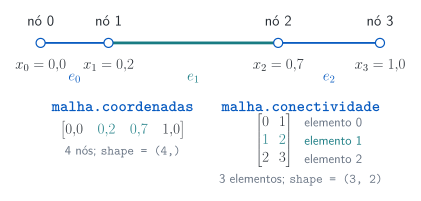
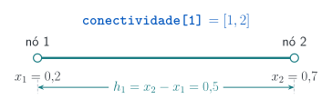
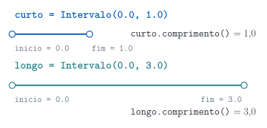

## Uma malha 1D e seus atributos {.diagram-slide}

Os **nós** são pontos. Cada **elemento** liga dois nós. O índice do nó identifica uma posição no vetor; a coordenada indica sua localização no domínio.

{.diagrama fig-alt="Malha não uniforme com quatro nós e três elementos. Os arrays de coordenadas e conectividade identificam o elemento 1 entre os nós 1 e 2."}

## Coordenadas e conectividade

As coordenadas localizam os nós. Cada linha da conectividade contém os índices dos dois nós que formam um elemento.

```{pyodide}
import numpy as np

coordenadas = np.array([0.0, 0.2, 0.7, 1.0])
conectividade = np.array([[0, 1], [1, 2], [2, 3]])
print("Coordenadas:", coordenadas)
print("Primeiro elemento:", conectividade[0])
```

## O comprimento de um elemento {.diagram-slide}

Uma linha da conectividade fornece os índices $i_e$ e $j_e$. Buscamos as coordenadas desses nós e calculamos $h_e=x_{j_e}-x_{i_e}$.

{.diagrama fig-alt="O elemento 1 liga os nós de coordenadas 0,2 e 0,7, com comprimento 0,5."}

O mesmo cálculo pode ser aplicado a todas as linhas do array de conectividade.

## Uma função representa uma operação {.output-columns}

Retomando funções com tipos: calcular comprimentos é uma responsabilidade pequena e bem definida. A anotação `np.ndarray` indica um array; não verifica seu formato nem a validade dos índices.

```{pyodide}
import numpy as np


def comprimentos(coordenadas: np.ndarray, conectividade: np.ndarray) -> np.ndarray:
    return coordenadas[conectividade[:, 1]] - coordenadas[conectividade[:, 0]]

x = np.array([0.0, 0.3, 1.0])
elementos = np.array([[0, 1], [1, 2]])
print(comprimentos(x, elementos))
```

## Um módulo permite reutilizar código

Um módulo é um arquivo Python que podemos importar. O pacote `malhalib` reúne os módulos `calculos` e `malha` usados nos notebooks e nas aulas.

```{pyodide}
import numpy as np
from malhalib.calculos import calcular_comprimentos

x = np.array([0.0, 0.3, 1.0])
elementos = np.array([[0, 1], [1, 2]])
print(calcular_comprimentos(x, elementos))
```

## Recapitulação: dados e métodos {.output-columns}

Na aula 04, vimos que cada instância guarda seus atributos. Aqui, `__init__` recebe os limites e o método consulta esses dados por meio de `self`.

```{pyodide}
class Intervalo:
    def __init__(self, inicio: float, fim: float) -> None:
        self.inicio, self.fim = inicio, fim

    def comprimento(self) -> float:
        return self.fim - self.inicio

curto, longo = Intervalo(0.0, 1.0), Intervalo(0.0, 3.0)
print("Comprimentos:", curto.comprimento(), longo.comprimento())
```

## Duas instâncias, dois estados {.diagram-slide}

Cada instância guarda seus próprios valores de `inicio` e `fim`. O mesmo método consulta os atributos da instância recebida como `self`.

{.diagrama fig-alt="Duas instâncias de Intervalo: curto vai de zero a um e longo vai de zero a três, com comprimentos um e três."}

## `dataclass`: declarar os campos {.output-columns}

`@dataclass` gera um construtor e uma representação textual a partir dos campos declarados. Métodos específicos continuam sendo escritos por nós.

```{pyodide}
from dataclasses import dataclass


@dataclass
class Intervalo:
    inicio: float
    fim: float

intervalo = Intervalo(0.0, 2.0)
print(intervalo)
```

## Tipos e validação têm papéis diferentes {.output-columns}

`valor: float` declara o tipo esperado. A chamada abaixo é **intencionalmente incompatível**: um verificador como mypy a sinalizaria. O Python, sozinho, não verifica a anotação ao construir o objeto.

```{pyodide}
from dataclasses import dataclass


@dataclass
class Medida:
    valor: float

medida = Medida("texto")  # Experimento: mypy sinalizaria esta chamada.
print("Tipo recebido:", type(medida.valor).__name__)
```

## Validar exige uma ação explícita {.output-columns}

`__post_init__` é chamado depois do construtor gerado pela dataclass. Ele pode verificar condições necessárias para que o objeto tenha significado.

```{pyodide}
from dataclasses import dataclass


@dataclass
class Intervalo:
    inicio: float
    fim: float

    def __post_init__(self) -> None:
        if self.fim <= self.inicio:
            raise ValueError("O fim deve ser maior que o início.")

print(Intervalo(0.0, 2.0))
```

## Arrays pedem cuidados com igualdade

Para arrays, `==` produz uma comparação por entrada. Em `Malha1D`, `eq=False` desativa a igualdade automática da dataclass; comparamos os dados explicitamente.

```{pyodide}
import numpy as np

x = np.array([0.0, 0.5, 1.0])
y = np.array([0.0, 0.5, 1.0])
print("Comparação por entrada:", x == y)
print("Mesmos valores?", np.array_equal(x, y))
```

## `Malha1D`: dados e cálculo juntos

`Malha1D` guarda coordenadas e conectividade; seu método `comprimentos()` reutiliza a função do módulo `calculos`. A construção verifica os formatos e copia as entradas.

```{pyodide}
import numpy as np
from malhalib.malha import Malha1D

x = np.array([0.0, 0.2, 0.7, 1.0])
elementos = np.array([[0, 1], [1, 2], [2, 3]])
malha = Malha1D(x, elementos)
print("Nós:", malha.coordenadas)
print("Comprimentos:", malha.comprimentos())
```

## Uma função constrói a malha uniforme {.output-columns}

`criar_malha_uniforme` organiza a criação das coordenadas e dos elementos. Para $n$ elementos em $[0,L]$, temos $n+1$ nós e comprimento $L/n$ por elemento.

```{pyodide}
from malhalib.malha import criar_malha_uniforme

malha = criar_malha_uniforme(numero_elementos=4, comprimento=2.0)
print("Nós:", malha.coordenadas)
print("Elementos:\n", malha.conectividade)
print("Comprimentos:", malha.comprimentos())
```

## Copiar entradas protege o objeto

Alterar um array externo não deve mudar silenciosamente a malha criada. A cópia feita no construtor separa esses dados.

```{pyodide}
import numpy as np
from malhalib.malha import Malha1D

x = np.array([0.0, 0.4, 1.0])
malha = Malha1D(x, np.array([[0, 1], [1, 2]]))
x[1] = 0.9
print("Array externo:", x)
print("Coordenadas guardadas:", malha.coordenadas)
```

## Reconhecer uma entrada inválida

A validação recusa índices fora do vetor e elementos com comprimento não positivo. `try/except` permite tratar uma falha esperada sem interromper o restante do exemplo.

```{pyodide}
import numpy as np
from malhalib.malha import Malha1D

try:
    Malha1D(np.array([0.0, 1.0]), np.array([[0, 2]]))
except ValueError as erro:
    print("Entrada recusada:", erro)
```

## Verificações com uma resposta conhecida

Uma verificação útil compara o resultado com uma propriedade esperada. Na malha uniforme, os comprimentos são iguais e sua soma vale $L$.

```{pyodide}
import numpy as np
from malhalib.malha import criar_malha_uniforme

malha = criar_malha_uniforme(3, comprimento=2.0)
tamanhos = malha.comprimentos()
assert np.allclose(tamanhos, 2.0 / 3.0)
assert np.isclose(tamanhos.sum(), 2.0)
print("Verificações passaram:", tamanhos)
```

## Escolher a organização conforme o problema

Uma função basta para uma operação independente. A classe ajuda quando dados relacionados e operações pertencem ao mesmo objeto.

- A validação da malha ocorre na construção.
- Os atributos continuam mutáveis; mudanças posteriores exigem cuidado.
- As verificações locais não demonstram cobertura global sem lacunas ou sobreposições.

## Para experimentar e estudar

Altere o número de elementos, construa uma malha não uniforme e confira seus comprimentos. O pacote local é instalado em modo editável no ambiente Pixi.

- [Notebook suplementar 08](suplementos/notebooks/08-organizacao-e-dataclasses.ipynb)
- [Módulos no Python](https://docs.python.org/3/tutorial/modules.html)
- [`dataclasses`](https://docs.python.org/3/library/dataclasses.html)
- [Código de `malhalib`](malhalib/malha.py)
