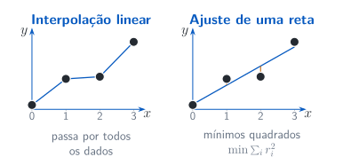

## Quatro perguntas diferentes

Cada pergunta define um problema e exige hipóteses próprias. A interface da biblioteca deve ser escolhida depois de identificar o que procuramos.

| Pergunta | Resultado procurado | Interface |
|---|---|---|
| Onde $f(x)=0$? | Uma raiz | `root_scalar` |
| Quais parâmetros aproximam os dados? | Parâmetros do modelo | `curve_fit` |
| Como avaliar entre dados conhecidos? | Uma interpolação | `np.interp`, `CubicSpline` |
| Como um estado evolui no tempo? | Solução de uma EDO | `solve_ivp` |

## Bisseção: começar por um intervalo {.output-columns}

Se $f$ é contínua e tem sinais opostos nos extremos, existe uma raiz no intervalo. A bisseção reduz sucessivamente um intervalo com mudança de sinal.

```{pyodide}
from scipy.optimize import root_scalar

def f(x: float) -> float:
    return x**2 - 2.0

resultado = root_scalar(
    f, bracket=(0.0, 2.0), method="bisect", xtol=1e-10
)
print("Sinais nos extremos:", f(0.0), f(2.0))
print("Convergiu?", resultado.converged)
print("Raiz:", resultado.root)
```

## Conferir convergência, resíduo e erro {.output-columns}

`converged` informa se o método satisfez seu critério de convergência; $|f(x)|$ mede o resíduo da equação. Aqui conhecemos $\sqrt2$ e podemos observar o erro na raiz.

```{pyodide}
from math import sqrt
from scipy.optimize import root_scalar

def f(x: float) -> float:
    return x**2 - 2.0

resultado = root_scalar(f, bracket=(0, 2),
                        method="bisect", xtol=1e-10)
print("Convergiu?", resultado.converged)
print("Resíduo:", abs(f(resultado.root)))
print("Erro:", abs(resultado.root - sqrt(2)))
```

## Newton: fornecer a derivada {.output-columns}

Newton usa a derivada e uma estimativa inicial; sua convergência depende do problema e do ponto inicial. Para $f(x)=x^2-2$, temos $f'(x)=2x$.

```{pyodide}
from scipy.optimize import root_scalar

def f(x: float) -> float:
    return x**2 - 2.0

def derivada(x: float) -> float:
    return 2.0 * x

resultado = root_scalar(
    f, x0=1.5, fprime=derivada, method="newton"
)
print("Convergiu?", resultado.converged)
print("Raiz:", resultado.root)
```

## Dois parâmetros, dois nomes

Desempacotar associa cada valor de uma sequência a um nome. A ordem dos nomes deve acompanhar a ordem dos parâmetros do modelo.

```{pyodide}
parametros = [2.0, 1.0]
inclinacao, intercepto = parametros
print("Inclinação:", inclinacao)
print("Intercepto:", intercepto)
```

## Ajustar parâmetros por mínimos quadrados {.output-columns}

`curve_fit` ajusta parâmetros por mínimos quadrados. Para $y=ax+b$, minimizamos $\sum_i[y_i-(ax_i+b)]^2$.

```{pyodide}
import numpy as np
from scipy.optimize import curve_fit

def modelo(x: np.ndarray, a: float, b: float) -> np.ndarray:
    return a * x + b
x = np.arange(4.0)
y = 2*x + 1
parametros, _ = curve_fit(modelo, x, y, p0=(1, 0))
a, b = parametros
print("a e b:", a, b)
print("Resíduos:", y - modelo(x, a, b))
```

## Medições sintéticas e modelo ajustado {.plot-slide}

Medições sintéticas incluem pequenos desvios em relação a uma reta. O ajuste busca aproximar o conjunto; ele não precisa passar por cada ponto.

```{pyodide}
import matplotlib.pyplot as plt
from numpy import ndarray
from scipy.optimize import curve_fit
def modelo(x: ndarray, a: float, b: float) -> ndarray:
    return a * x + b
x = [0, 1, 2, 3, 4, 5]
y = [0.36, 1.98, 3.32, 4.89, 6.51, 7.85]
a, b = curve_fit(modelo, x, y)[0]
fig, ax = plt.subplots(layout="constrained")
ax.plot(x, y, "o", x, [a*xi + b for xi in x])
ax.set(xlabel="x", ylabel="y")
ax.legend(["Medições", "Ajuste"])
plt.show()
```

## Interpolação e ajuste {.diagram-slide}

A interpolação reproduz os valores nos nós. O ajuste de mínimos quadrados busca uma reta que aproxime o conjunto; os segmentos laranja representam resíduos.

{.diagrama fig-alt="Os mesmos quatro pontos, unidos por interpolação linear à esquerda e aproximados por uma reta de mínimos quadrados à direita"}

## Interpolar: passar pelos valores dados {.output-columns}

`np.interp` constrói uma interpolação linear unidimensional. Os nós devem estar em ordem crescente; aqui consultamos apenas o intervalo dos dados.

```{pyodide}
import numpy as np

x_nos = np.linspace(0.0, np.pi, 5)
y_nos = np.sin(x_nos)
x_consulta = np.pi / 8.0
interpolado = np.interp(x_consulta, x_nos, y_nos)
print("Interpolação:", interpolado)
print("Referência:", np.sin(x_consulta))
```

## Spline cúbica: polinômios por partes {.output-columns}

`CubicSpline` une trechos cúbicos com continuidade das duas primeiras derivadas. A condição `natural` impõe segunda derivada nula nas extremidades.

```{pyodide}
import numpy as np
from scipy.interpolate import CubicSpline

x_nos = np.linspace(0.0, np.pi, 5)
y_nos = np.sin(x_nos)
spline = CubicSpline(
    x_nos, y_nos, bc_type="natural", extrapolate=False
)
print("Spline em pi/8:", spline(np.pi / 8.0))
print("Referência:", np.sin(np.pi / 8.0))
reproduz = np.allclose(spline(x_nos), y_nos)
print("Reproduz os nós?", reproduz)
```

## Comparar interpolações entre os nós {.plot-slide}

Ambas reproduzem os valores amostrados, mas podem diferir entre os nós. As condições naturais combinam com a segunda derivada de $\sin(x)$ em $0$ e $\pi$.

```{pyodide}
import numpy as np
import matplotlib.pyplot as plt
from scipy.interpolate import CubicSpline
nos = np.linspace(0.0, np.pi, 5)
y = np.sin(nos)
x = np.linspace(0.0, np.pi, 201)
s = CubicSpline(nos, y, bc_type="natural")
fig, ax = plt.subplots(layout="constrained")
ax.plot(x, np.sin(x), x, np.interp(x, nos, y), x, s(x))
ax.set(xlabel="x", ylabel="y")
ax.legend(["Exata", "Linear", "Spline"])
plt.show()
```

## EDO: uma derivada e um estado inicial {.output-columns}

`solve_ivp` aproxima a solução de um problema de valor inicial. Para $y'=-2y$, $y(0)=1$, a referência é $y(t)=e^{-2t}$.

```{pyodide}
import numpy as np
from scipy.integrate import solve_ivp

def derivada(t: float, y: np.ndarray) -> np.ndarray:
    return -2.0 * y

solucao = solve_ivp(
    derivada, (0.0, 2.0), [1.0],
    t_eval=np.linspace(0.0, 2.0, 41),
    rtol=1e-8, atol=1e-10
)
print("Sucesso?", solucao.success)
print("Shape de y:", solucao.y.shape)
```

## Conferir a evolução calculada {.plot-slide}

A solução tem uma linha por componente do estado e uma coluna por tempo retornado. Podemos compará-la com a referência nos mesmos tempos.

```{pyodide}
import numpy as np
import matplotlib.pyplot as plt
from scipy.integrate import solve_ivp
def f(t: float, y: np.ndarray) -> np.ndarray:
    return -2.0 * y
s = solve_ivp(f, (0, 2), [1], rtol=1e-8, atol=1e-10)
fig, ax = plt.subplots(layout="constrained")
ax.plot(s.t, np.exp(-2*s.t), s.t, s.y[0], "o")
ax.set(xlabel="t", ylabel="y(t)")
ax.legend(["Referência", "solve_ivp"])
plt.show()
```

## `t_eval` escolhe os tempos de saída {.output-columns}

O integrador escolhe passos internos adaptativamente e avalia a resposta nos tempos solicitados. Aumentar `t_eval` não força passos internos menores.

```{pyodide}
import numpy as np
from scipy.integrate import solve_ivp

def f(t: float, y: np.ndarray) -> np.ndarray:
    return -2.0 * y
tempos = np.linspace(0, 2, 41)
saida = solve_ivp(f, (0, 2), [1], t_eval=tempos,
                  rtol=1e-8, atol=1e-10)
passos = solve_ivp(f, (0, 2), [1],
                   rtol=1e-8, atol=1e-10)
print("Tempos de saída:", saida.t.size)
print("Passos aceitos:", passos.t.size - 1)
```

## Experimente outra condição inicial {.output-columns}

Edite `valor_inicial` e compare com $y(1)=y(0)e^{-2}$. O erro é medido em $t=1$.

```{pyodide}
import numpy as np
from scipy.integrate import solve_ivp

def derivada(t: float, y: np.ndarray) -> np.ndarray:
    return -2.0 * y
valor_inicial = 3.0
solucao = solve_ivp(
    derivada, (0, 1), [valor_inicial],
    t_eval=[1], rtol=1e-8, atol=1e-10)
erro = abs(solucao.y[0, -1] - valor_inicial*np.exp(-2))
print("Sucesso?", solucao.success)
print(f"y(1): {solucao.y[0, -1]:.6f}")
print(f"Erro observado: {erro:.2e}")
```

## Para experimentar e estudar

Os exemplos mostram verificações em casos conhecidos. As hipóteses do modelo e os critérios do algoritmo continuam essenciais em cada aplicação.

- [Notebook suplementar 09](suplementos/notebooks/09-topicos-complementares.ipynb)
- [`root_scalar`](https://docs.scipy.org/doc/scipy/reference/generated/scipy.optimize.root_scalar.html)
- [`curve_fit`](https://docs.scipy.org/doc/scipy/reference/generated/scipy.optimize.curve_fit.html)
- [`CubicSpline`](https://docs.scipy.org/doc/scipy/reference/generated/scipy.interpolate.CubicSpline.html)
- [`solve_ivp`](https://docs.scipy.org/doc/scipy/reference/generated/scipy.integrate.solve_ivp.html)
